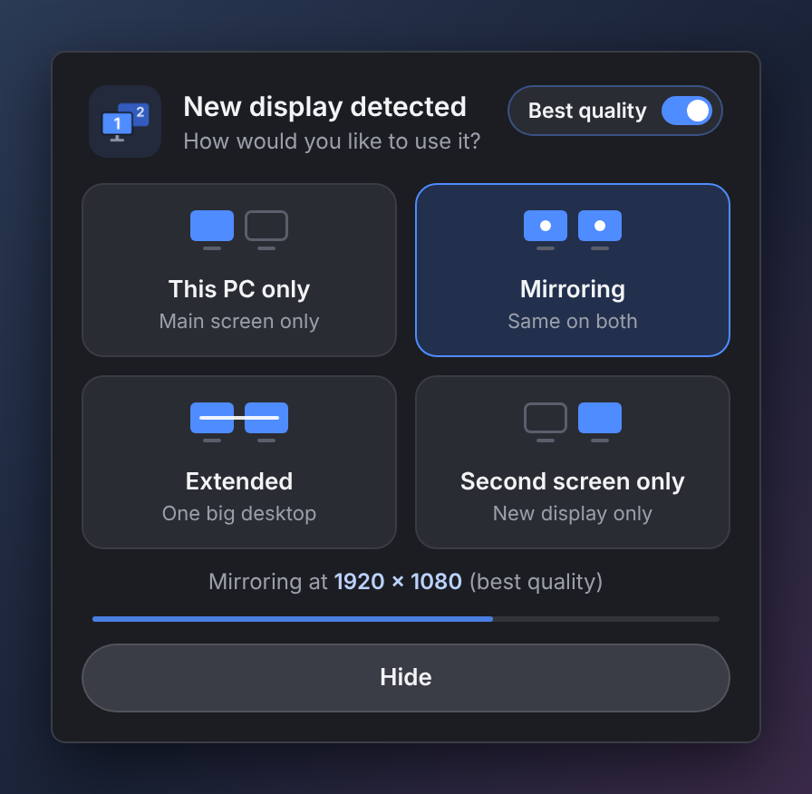
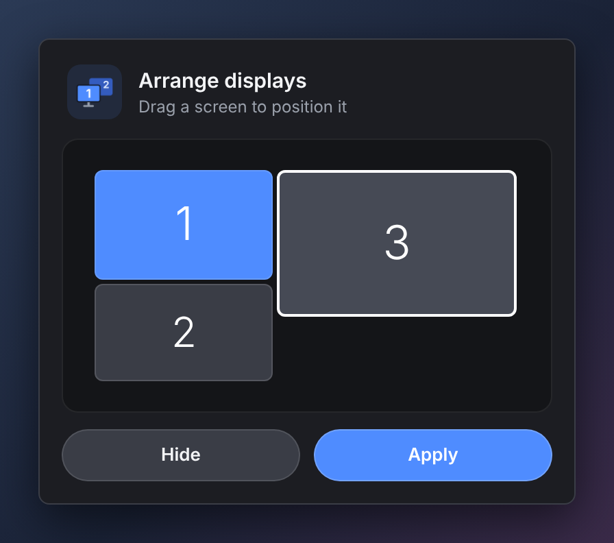
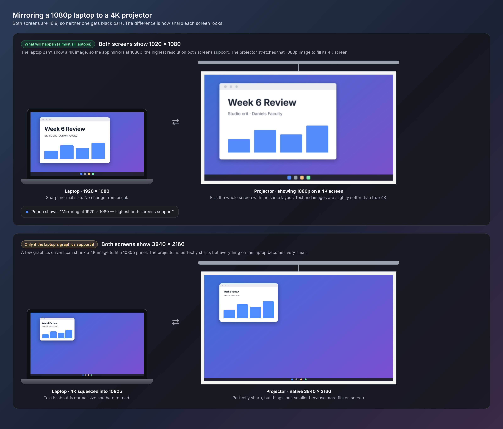

<p align="center">
  
</p>

<h1 align="center">Display Prompt</h1>

<p align="center">
  <b>Plug in a monitor or projector, and pick how to use it from a pop-up in the corner of the screen.</b><br>
  A small Windows tray app for classrooms, meeting rooms and hot desks.
</p>

<p align="center">
  <a href="../../releases/latest"></a>
  
  
  <a href="LICENSE"></a>
</p>

---

<p align="center">
  
</p>

## Why

When someone connects a laptop to a projector, Windows often picks the wrong mode, and many people don't know about **Win + P**. Display Prompt asks them straight away, in plain words, with large buttons:

| Option | What it does |
|---|---|
| **This PC only** | Show only on the laptop's own screen |
| **Mirroring** | Show the same thing on both screens |
| **Extended** | One big desktop across all screens, then drag screens into position |
| **Second screen only** | Show only on the monitor or projector |

## Features

- **Pops up automatically** in the bottom-right corner when a new display is connected.
- **Mirrors by default.** A newly connected screen switches to Mirroring, which is what most presenters want.
- **Best quality switch.** When mirroring, uses the highest resolution both screens support, and shows which one it picked.
- **Arrange screens visually.** After choosing **Extended**, drag the numbered boxes around the main screen. They snap edge-to-edge, just like Windows Settings.
- **Identifies each screen.** While you arrange, a large number appears in the bottom-left of every physical screen, and the one you're moving lights up blue.
- **Gets out of the way.** The panel hides itself after 10 seconds (pausing while the mouse is over it), or as soon as an option is chosen.
- **Tray icon.** Click it to open the panel any time. Right-click it to restart or exit.
- **Self-healing.** If the app ever stops responding, it restarts itself. Problems are written to a small log file.
- **No admin rights needed to run**, and no network access, telemetry or data collection.

<p align="center">
  
  &nbsp;&nbsp;
  
</p>

## Download and install

1. Download **DisplayPrompt-x.y.z-win-x64.zip** from the [latest release](../../releases/latest) and extract it.
2. Right-click **Start**, choose **Terminal (Admin)**, then run:
   ```powershell
   cd "$HOME\Downloads\DisplayPrompt-x.y.z-win-x64"   # the folder you extracted
   Set-ExecutionPolicy -Scope Process Bypass
   .\install.ps1
   ```
3. The icon appears in the system tray. Plug in a screen to try it.

The installer copies the app to `C:\Program Files\Ctrl+Alt+Elite\DisplayPrompt\` and starts it for **every user** at sign-in. The `.exe` is self-contained, so the PC does not need .NET installed.

To remove it, run `.\uninstall.ps1` the same way.

> Windows SmartScreen may warn about the download because the `.exe` isn't code-signed yet. Choose **More info → Run anyway**, or build it yourself (below).

Rolling it out to many PCs (Intune, SCCM, Group Policy)? See **[docs/DEPLOYMENT.md](docs/DEPLOYMENT.md)**.

## Build from source

You need Windows 10/11 and the **.NET 8 SDK** (`winget install Microsoft.DotNet.SDK.8`).

**Build and install in one step** (admin PowerShell):
```powershell
git clone https://github.com/LetsGetCracking/DisplayPrompt.git
cd DisplayPrompt
Set-ExecutionPolicy -Scope Process Bypass
.\build.ps1
```

**Build the `.exe` only:**
```powershell
dotnet publish -c Release -r win-x64 --self-contained true -p:PublishSingleFile=true -p:IncludeNativeLibrariesForSelfExtract=true -o publish
```
The result is `publish\DisplayPrompt.exe`.

**Quick test without installing:** `dotnet run -- --show` opens the panel straight away.

## Using it

| Action | How |
|---|---|
| Open the panel | Left-click the tray icon, or connect a screen |
| Pick a mode | Click one of the four tiles |
| Arrange screens | Choose **Extended**, drag the boxes, then click **Apply** |
| Dismiss | **Hide**, **Esc**, or wait 10 seconds |
| Move the panel | Drag it by the header |
| Restart or exit | Right-click the tray icon |

### Best quality and mirroring

When screens are mirrored, Windows shows the *same* image on both, so they must share one resolution. With **Best quality** on, Display Prompt picks the highest resolution both screens can display.

For example, with a 1080p laptop and a 4K projector, both screens run at 1920 × 1080 and the projector scales that up to fill its screen. For true 4K on the projector, choose **Second screen only**.

<p align="center">
  
</p>

The setting is remembered per user in `HKCU\Software\Ctrl+Alt+Elite\DisplayPrompt`.

## Troubleshooting

| Problem | Fix |
|---|---|
| Panel doesn't appear | Right-click the tray icon, then **Restart Display Prompt** |
| Panel doesn't pop up when a screen is connected | It only appears when the number of connected screens *goes up*. Use the tray icon. |
| Something else odd | Check the log: **Win + R** → `notepad %LOCALAPPDATA%\DisplayPrompt\log.txt` |

When reporting a bug, please [open an issue](../../issues) and include the last 20 lines of the log.

## How it works

The app uses the same Windows display API as **Win + P** and the Settings app. See **[docs/HOW-IT-WORKS.md](docs/HOW-IT-WORKS.md)** for a tour of the code.

## Roadmap

- Remember the mode used last time for each projector
- `settings.json` for per-room defaults (default mode, countdown length)
- Option to send sound to the projector's HDMI output
- Signed MSI installer

## License

[MIT](LICENSE) © 2026 Edwin Cooke · Ctrl+Alt+Elite
